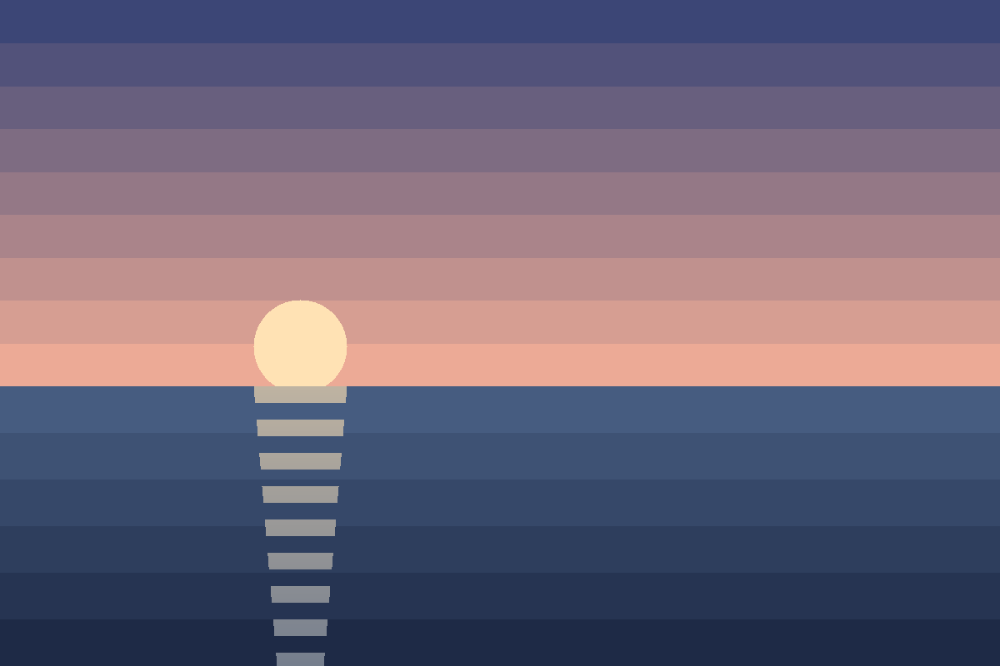
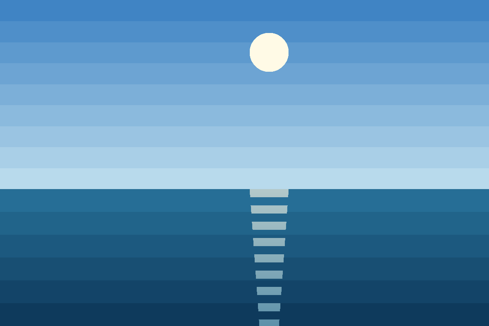

# Coast

One horizon, three hours apart. The album wraps its figures in a
`gallery-grid` block so they sit side by side on a wide screen and stack on a
narrow one.

<figure>

<figcaption><strong>Dawn.</strong> Cold light, low sun.</figcaption>
</figure>

<figure>

<figcaption><strong>Noon.</strong> Flat light, high sun.</figcaption>
</figure>

<figure>

<figcaption><strong>Dusk.</strong> The sun sits on the water line.</figcaption>
</figure>

> The sea is the same sea every hour; only the light disagrees.

## Plate notes

Dawn
: 1200 × 800 PNG, nine sky bands.
Noon
: 1200 × 800 PNG, the sun at sixteen percent height.
Dusk
: 1200 × 800 PNG, the widest reflection[^reflection].

The low-tide study hangs in its own room: see the plate below.

[^reflection]: The reflection is a stepped column, half as wide at the bottom of the frame as at the horizon.
