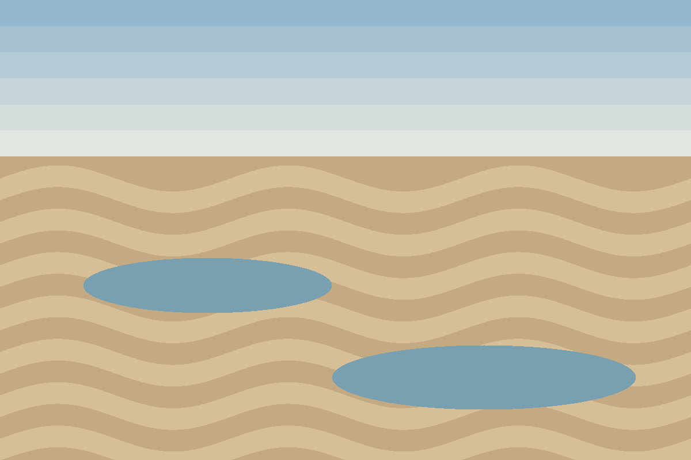

# Low tide

<figure>

<figcaption><strong>Low tide.</strong> 1200 × 800 PNG. Two pools and the ripples the water left behind.</figcaption>
</figure>

A single-image page uses the same `main` layout as an album. With one figure
there is nothing to grid, so the plate takes the full width of the wall and
its caption reads like a museum label.

This page sits two levels deep (`photos/coast/low-tide.html`). The image URL is
still page-relative: `low-tide.assets/low-tide.png`.
