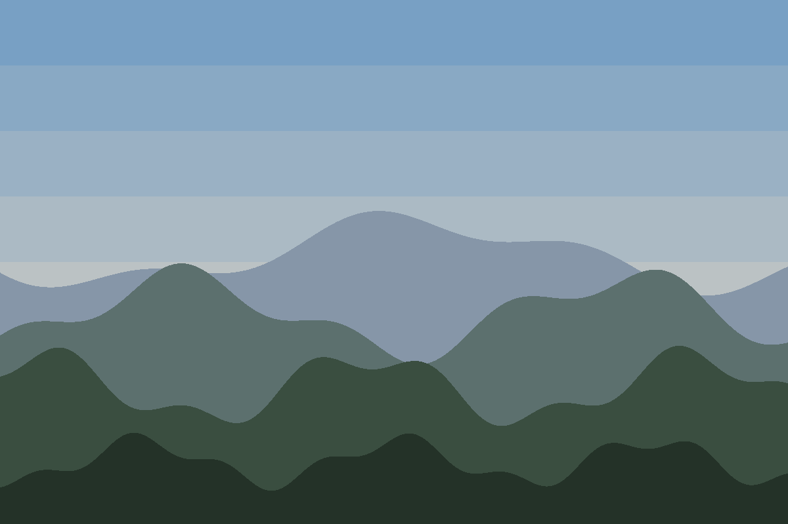
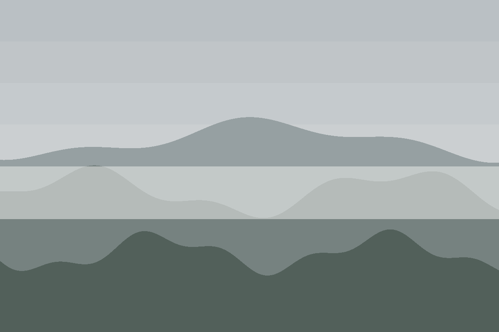
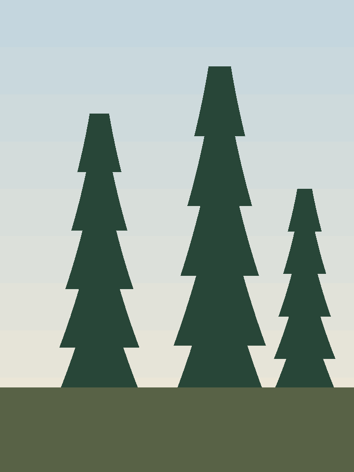

# Hills

Inland, the layers stack up. This album mixes landscape and portrait plates
so the grid has to cope with uneven heights.

<div class="gallery-grid">

<figure>



<figcaption><strong>Ridge.</strong> Four layers, nearest darkest.</figcaption>
</figure>

<figure>



<figcaption><strong>Fog.</strong> The middle band washes out.</figcaption>
</figure>

<figure>



<figcaption><strong>Pines.</strong> Portrait, 720 × 960.</figcaption>
</figure>

</div>

## Plates

| Plate | Size | Orientation |
| --- | --- | --- |
| Ridge | 1200 × 800 | Landscape |
| Fog | 1200 × 800 | Landscape |
| Pines | 720 × 960 | Portrait |

## Authoring a figure

Captions are raw HTML around an ordinary Markdown image. Keep the blank lines
so the image is still Markdown, which is what lets Boris rewrite its URL:

```markdown
<figure>


<figcaption><strong>Ridge.</strong> Four layers, nearest darkest.</figcaption>
</figure>
```

<Aside kind="note">

Alt text describes the picture. The caption labels it. They are not the same
sentence.

</Aside>

<Aside kind="info">

Scale images before you commit them. A 1200-pixel-wide PNG of flat colour is
a few kilobytes; a camera original is several megabytes.

</Aside>

<Aside kind="warning">

Raw `` is not rewritten or checked. Use Markdown image syntax for
anything in a `.assets/` folder.

</Aside>

<Aside kind="danger">

A missing asset fails the build with `EASSET`. That is the point.

</Aside>
