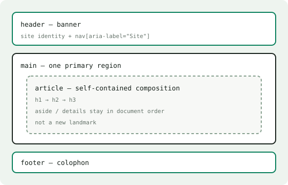

# One main region

`main` marks the content the page exists for. It appears once, it is not
wrapped in anything that repeats on every page, and it carries `tabindex="-1"`
so the skip link can drop focus straight into it.

## What belongs

Everything unique to this page: the heading, the prose, the figures, and the
one-off list of children below. If a block would repeat on the next page, it
belongs in the banner or the footer instead.

## What does not

Persistent navigation, the site name, and the colophon all repeat. They get
their own landmarks, outside `main`.

<figure>

<figcaption><strong>Nested, not stacked.</strong> The article lives inside <code>main</code>; the banner and footer are its siblings.</figcaption>
</figure>

<Aside kind="warning">

Exactly one `main` per document. A second one does not add a second region —
it adds a second thing claiming to be the first.

</Aside>

No. `main` is the document's one primary region. `article` is a composition:
this page's body is wrapped in one because the entry stands on its own. A page
may hold several articles, but only ever one `main`.

The heading order continues in [Heading hierarchy](headings.md).
